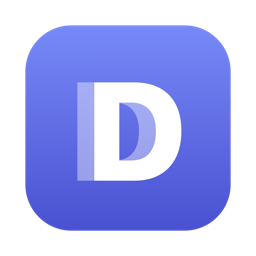

<p align="center">
  
</p>

<h1 align="center">Discord Desync</h1>

<p align="center">
  A tiny native macOS app that opens Discord through a local <a href="https://github.com/hufrea/byedpi">ByeDPI</a> proxy.<br>
  No system proxy. No firewall changes. Only the app's own WebKit view is proxied.
</p>

<p align="center">
  
  
  
</p>

## Features

- **Native window** for `https://discord.com/app`, using a per-app SOCKS5 proxy on `127.0.0.1`
- **Bundled ByeDPI**: starts when the app opens, stops when it quits
- **Live status** of the proxy and page loading in the window
- **Proxy menu** with start, restart, stop, and status
- **Persistent login**: cookies live in WebKit's data store for the app
- **Safe media permissions**: mic and camera are auto-granted only on Discord domains
- **macOS editing shortcuts** work in Discord messages
- **Safari identity** so Discord treats the embedded view as a supported browser
- **Settings window**: Discord URL, health-check URL, SOCKS port, strategy preset, custom flags, media permission behavior

## Quick start

Requires macOS 14+ and Xcode Command Line Tools (`xcode-select --install`).

```bash
git submodule update --init --recursive
scripts/build.sh --install
```

This builds `build/Discord Desync.app` and installs it to `/Applications`. Drop `--install` to only build.

## Settings

Open **Discord Desync > Settings...**

| Preset | Flags |
| --- | --- |
| Balanced (default) | `--disorder 1 --auto=torst --tlsrec 1+s` |
| Conservative | `--auto=torst --tlsrec 1+s` |
| Aggressive | `--disorder 1 --auto=torst --tlsrec 1+s --split 1+s` |
| Custom | your own ByeDPI flags |

If your network needs a different mode, try another preset or use Custom.

## Where things live

| What | Path |
| --- | --- |
| ByeDPI PID file and log | `~/Library/Application Support/Discord Desync` |
| Discord login and cookies | `~/Library/WebKit/com.omerdikyol.discorddesync` |

After a reinstall macOS may ask for microphone or camera access again. Grant it once.

## Architecture

| File | Role |
| --- | --- |
| `main.swift` | AppKit lifecycle and WebKit presentation |
| `ProxyController.swift` | Runs ByeDPI operations on a background queue so health checks and restarts never freeze the UI |
| `Settings.swift` | Persisted configuration and strategy presets |
| `SettingsWindowController.swift` | Settings UI |
| `discord-desync-proxy.sh` | Process discovery, lifecycle, health checks |

Start with [`main.swift`](Sources/DiscordDesync/main.swift), then [`ProxyController.swift`](Sources/DiscordDesync/ProxyController.swift) and [`Settings.swift`](Sources/DiscordDesync/Settings.swift). [`scripts/test.sh`](scripts/test.sh) checks the local build and proxy setup. Read it before running: it starts processes and inspects local runtime state.

## Credits

Built on [`hufrea/byedpi`](https://github.com/hufrea/byedpi) (MIT). Discord Desync is not affiliated with Discord or ByeDPI. It is a local convenience wrapper around WebKit and ByeDPI.
